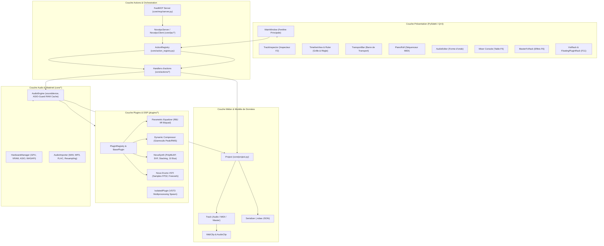
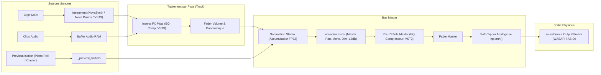
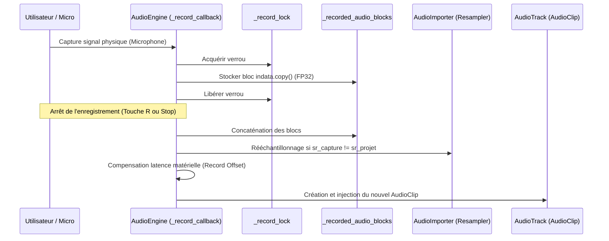
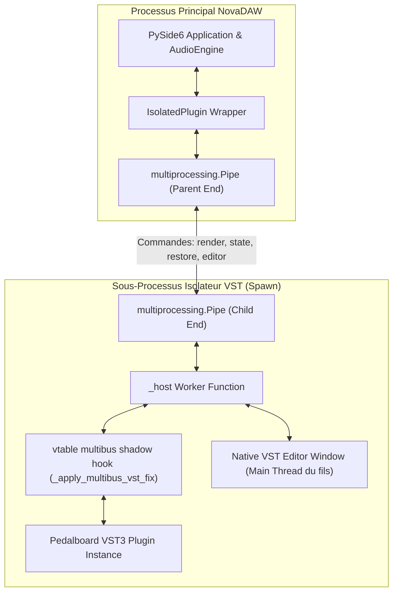

# 🏛️ Architecture Globale du Système NovaDAW

Ce document décrit en détail l'architecture logicielle, les flux de données et l'organisation modulaire de **NovaDAW**.

---

## 1. Vue d'Ensemble des Couches Logicielles

NovaDAW repose sur une architecture en couches découplées pour garantir une fluidité totale de l'interface utilisateur, une latence audio minimale et une sécurité absolue face aux extensions externes.

---

## 2. Le Pipeline Audio Temps Réel (Signal Flow)

Le traitement audio temps réel s'exécute dans un thread de haute priorité géré par la bibliothèque `sounddevice` (PortAudio).

### Diagramme de Flux Audio (De la Timeline aux Haut-Parleurs) :

### Détails Techniques du Pipeline :
1. **Échantillonnage et Grille Temporelle** :
   À chaque appel de `_audio_callback(outdata, frames, time_info, status)` :
   - NovaDAW calcule le nombre de temps musicaux correspondant aux `frames` reçus :
     $$\Delta\text{beats} = \frac{\text{frames}}{\text{sample\_rate}} \times \frac{\text{BPM}}{60}$$
   - Si la lecture est en cours, `current_beat` avance de $\Delta\text{beats}$.
   - Si la boucle est active et dépasse `loop_end_beat`, le curseur se repositionne de façon parfaitement étanche sur `loop_start_beat`.

2. **ASIO-Guard et Cache Hybride** :
   Pour éviter tout glitch ou décrochage audio (buffer underrun) lors de projets chargés :
   - NovaDAW intègre un pré-calcul et un système de cache en mémoire vive (`_track_audio_caches`).
   - Les pistes MIDI ou audio stables sont rendues en tâche de fond dans la mémoire vive, réduisant la charge CPU instantanée pendant la lecture continue.

3. **Prévisualisation à Latence Zéro** :
   - Lorsque l'utilisateur clique sur le clavier du Piano Roll ou sur un pad de batterie, un bloc audio est immédiatement injecté dans la file protégée `_preview_buffers`.
   - Ce signal traverse la chaîne d'effets de la piste sélectionnée (`_process_track_effects_isolated`) et s'additionne au mixage en cours avec un délai inférieur à 8 ms.

---

## 3. Le Pipeline d'Enregistrement Audio et MIDI

NovaDAW permet l'enregistrement direct de micros/lignes ainsi que l'enregistrement de patterns MIDI en temps réel.

---

## 4. Architecture de Commande Découplée : ActionRegistry, IPC et FastMCP

NovaDAW adopte un motif architectural de type **Command Pattern centralisé** :

1. **`core/action_registry.py`** :
   - Registre central de toutes les capacités exécutables du logiciel.
   - Toute fonction métier décorée avec `@action_registry.register` devient instantanément invocable par l'interface PySide6, par des scripts ou par un agent d'IA.
   - Les métadonnées (types des paramètres, docstrings, valeurs par défaut) sont inspectées dynamiquement via le module `inspect`.

2. **`core/ipc/` (Pont TCP IPC Local)** :
   - `NovaIpcServer` s'exécute sur le port local (par défaut 8765, ou port incrémenté si occupé).
   - Les commandes transitent au format JSON : `{"action": "nom_action", "params": {...}}`.
   - Les commandes reçues du réseau sont dispatchées en toute sécurité sur le **Thread Principal Qt** via les mécanismes de signaux/slots pour éviter tout crash de mémoire partagée.

3. **`core/mcp/server.py` (Serveur FastMCP)** :
   - Expose automatiquement les 31+ actions sous forme d'outils Model Context Protocol aux agents intelligents (Antigravity, Claude Desktop, Cursor).
   - **Découplage absolu** : Le serveur FastMCP n'a pas besoin d'être édité manuellement quand une nouvelle action est créée ; il lit dynamiquement le registre.

---

## 5. Hébergement Crash-Isolé des Plugins VST3 (`core/vst_host.py`)

Les plugins VST3 natifs externes (Pedalboard / JUCE) sont programmés en C++ natif et peuvent contenir des erreurs de mémoire fatales pour un processus Python. NovaDAW résout ce problème par une isolation de processus complète :

### Avantages Majeurs de cette Architecture :
- **Immunité aux Segfaults** : Si un plugin VST3 subit une violation d'accès mémoire (`0xC0000005`), le sous-processus s'arrête brutalement, mais le processus principal de NovaDAW reste intact et continue de jouer le reste du projet.
- **Support des fenêtres graphiques natives** : L'éditeur natif du plugin VST3 s'exécute sur le thread principal du processus fils, évitant tout blocage de la boucle d'événements Qt de NovaDAW.
