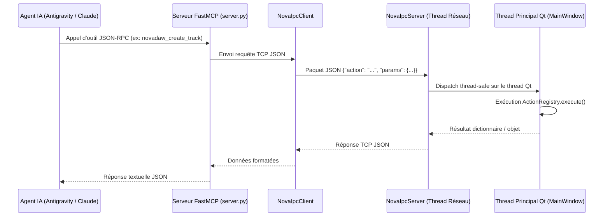

# 🤖 Spécification du Protocole MCP & Orchestration par IA

Ce document décrit en détail l'intégration de NovaDAW avec le **Model Context Protocol (MCP)** et l'infrastructure de communication inter-processus (IPC) permettant aux agents intelligents (Claude Desktop, Google Antigravity, Cursor, Codex) de piloter le DAW en temps réel.

---

## 1. Principes de l'Orchestration IA dans NovaDAW

Contrairement aux DAWs traditionnels qui exigent des clics manuels pour chaque opération, NovaDAW a été conçu pour être **totalement pilotable par le code et les agents IA**.

### L'Architecture Tripartite :
1. **L'Application NovaDAW (PySide6)** :
   Héberge le serveur TCP local non bloquant `NovaIpcServer` (`core/ipc/ipc_server.py`) sur le port 8765 (ou port suivant si occupé).
2. **Le Registre Déclaratif (`core/action_registry.py`)** :
   Recense chaque action avec son nom, sa docstring, ses types de paramètres et sa logique métier.
3. **Le Serveur FastMCP (`core/mcp/server.py`)** :
   Lit dynamiquement le registre au démarrage, génère automatiquement les wrappers typés JSON-RPC conformes au standard MCP, et communique avec NovaDAW via `NovaIpcClient`.



---

## 2. Catalogue des Outils MCP Disponibles (44 Outils)

### 2.1. Gestion de Projet & Timeline
- `novadaw_get_project_summary` : Synthèse complète du projet (nom, BPM, signature, boucle, liste des pistes, nombre de clips).
- `novadaw_create_track` : Création immédiate d'une piste audio ou MIDI avec attribution de couleur.
- `novadaw_set_track_controls` : Réglage du volume (0.0 - 1.5), panoramique (-1.0 à 1.0), mute et solo d'une piste.
- `novadaw_save_project` : Sauvegarde du projet au format `.ndaw`.
- `novadaw_export_wav` : Rendu et mixdown audio du projet complet en fichier WAV haute résolution.
- `novadaw_import_audio_file` : Importation d'un fichier audio (WAV, MP3, FLAC, OGG, AIFF, M4A) sur une piste existante ou nouvelle.
- `novadaw_new_project` : Réinitialisation vers un projet vierge.
- `novadaw_load_demo_project` : Chargement du projet musical de démonstration.
- `novadaw_split_clip` : Découpe d'un clip à une position temporelle précise.
- `novadaw_copy_clip` / `novadaw_paste_clip` : Presse-papier pour duplication de clips sur la timeline.
- `novadaw_set_grid` : Configuration de la résolution temporelle et de l'aimantage (Snap).
- `novadaw_set_editing_tool` : Sélection de l'outil d'édition (`select`, `split`, `erase`).

### 2.2. Transport & Boucle
- `novadaw_control_transport` : Pilotage du transport (`play`, `pause`, `stop`, `record`, `seek`, `goto_start`, `goto_end`).
- `novadaw_set_loop_region` : Définition des bornes de boucle en temps (début, fin, activation).
- `novadaw_adjust_loop_bounds` : Ajustement relatif des marqueurs de boucle.
- `novadaw_get_transport_state` : Mesure de la position actuelle de la tête de lecture, tempo et statut.
- `novadaw_set_bpm` : Modification à chaud du tempo du projet.

### 2.3. Séquençage MIDI & Composition
- `novadaw_create_midi_clip` : Création d'un bloc MIDI sur une piste à une mesure donnée.
- `novadaw_add_midi_notes` : Injection de notes MIDI. Accepte les noms musicaux (`"C4"`, `"Eb3"`, `"Sol3"`) ou les numéros bruts (`60`, `63`).
- `novadaw_get_midi_notes` : Récupération de l'ensemble des notes d'un clip.
- `novadaw_list_midi_clips` : Liste exhaustive de tous les clips MIDI du projet.
- `novadaw_clear_midi_notes` : Vidage des notes d'un clip.
- `novadaw_remove_midi_notes` : Suppression ciblée par hauteur ou intervalle de temps.
- `novadaw_transpose_clip` : Transposition en demi-tons ou octaves.
- `novadaw_quantize_notes` : Recalage automatique sur la grille temporelle.

### 2.4. Plugins & Mixage Studio
- `novadaw_get_available_plugins` : Liste des plugins DSP enregistrés.
- `novadaw_add_plugin_to_track` : Insertion d'un plugin (Égaliseur, Compresseur, Mixeur) sur une piste ou sur le Master.
- `novadaw_remove_plugin_from_track` : Retrait d'un plugin par son `instance_id`.
- `novadaw_set_plugin_bypass` : Activation/désactivation (bypass) d'un plugin.
- `novadaw_configure_plugin` : Ajustement générique des paramètres d'un plugin.
- `novadaw_get_track_plugins` : Inspection détaillée de la pile d'effets d'une piste.
- `novadaw_configure_equalizer` : Réglage précis de l'égaliseur paramétrique ou application de presets (`bass_boost`, `vocal_clarity`, `warm_master`, `bright_air`, `flat`).
- `novadaw_configure_compressor` : Configuration du compresseur (threshold, ratio, attack, release, makeup, knee, mix) ou presets (`punchy_drums`, `vocal_leveler`, `master_glue`, `parallel_crush`).
- `novadaw_configure_mixer` : Contrôle global du bus Master (volume master, pan, mode mono, switch Dim -12 dB).
- `novadaw_get_mixer_levels` : Télémétrie des crêtes Peak L/R et RMS en direct.

### 2.5. Instruments Virtuels (NovaSynth & Nova Drums)
- `novadaw_configure_drum_machine` : Pilotage complet de Nova Drums VSTi (volume master, réverbération Freeverb intégrée, réglages par pad).
- `novadaw_configure_synth` : Configuration des paramètres généraux ou par couche du synthétiseur NovaSynth.
- `novadaw_add_synth_layer` : Ajout d'une nouvelle couche sonore superposée (Saw, Square, Sine, Noise, FM, SuperSaw).
- `novadaw_remove_synth_layer` : Suppression d'une couche sonore.
- `novadaw_set_synth_preset` : Application directe d'un des 34 presets d'usine de NovaSynth.
- `novadaw_get_synth_state` : Extraction complète de l'état du synthétiseur.

### 2.6. Matériel & Périphériques
- `novadaw_get_hardware_devices` : Détection matérielle (cartes graphiques GPU, VRAM, pilotes audio hôtes ASIO/WASAPI).
- `novadaw_set_audio_device` : Changement à chaud de la carte son de sortie, de la fréquence et du buffer.

---

## 3. Directives pour les Agents IA lors de la Création Musicale

Les règles suivantes sont issues de `GEMINI.md` et doivent être scrupuleusement respectées par les agents :

1. **Utilisation directe des outils MCP** : Dès que l'utilisateur demande de composer ou modifier le son, appeler immédiatement les outils `novadaw_*` via `call_mcp_tool(ServerName="novadaw", ...)`.
2. **Interdiction de reprogrammer le protocole** :
   - Ne jamais inspecter ni modifier `core/mcp/server.py` ou `core/mcp/` pour "chercher le chemin".
   - Ne jamais générer de scripts temporaires Python externes pour dialoguer avec NovaDAW : les outils MCP sont déjà branchés et fonctionnels.
3. **Workflow standard de composition** :
   ```
   1. novadaw_create_track       -> Crée la piste (MIDI ou Audio)
   2. novadaw_configure_synth     -> Règle le preset ou le son (ou novadaw_configure_drum_machine)
   3. novadaw_create_midi_clip   -> Crée le conteneur de notes
   4. novadaw_add_midi_notes     -> Injecte la mélodie, les accords ou le beat
   5. novadaw_control_transport  -> Lance la lecture (action: "play")
   ```

---

## 4. Comment Ajouter une Nouvelle Action Exposée à l'IA

Pour étendre les capacités de NovaDAW et les exposer automatiquement à l'IA :

1. Ouvrez (ou créez) un fichier dans `core/actions/` (ex: `core/actions/mon_action.py`).
2. Décorez la fonction avec `@action_registry.register` :
   ```python
   from core.action_registry import action_registry

   @action_registry.register(
       name="novadaw_ma_nouvelle_action",
       description="Explication précise destinée à l'IA sur ce que fait l'outil.",
       tags=["categorie"]
   )
   def ma_nouvelle_action(app, param1: str, param2: int = 10) -> dict:
       # 'app' est injecté automatiquement et correspond à l'instance de MainWindow
       ...
       return {"status": "success", "result": ...}
   ```
3. Si le fichier est nouveau, importez-le dans `core/actions/__init__.py`.
4. **C'est tout !** Le serveur FastMCP et le pont IPC exposent la commande automatiquement sans aucune autre modification.
